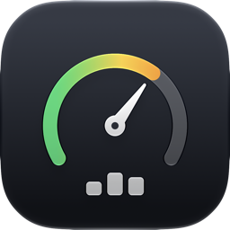
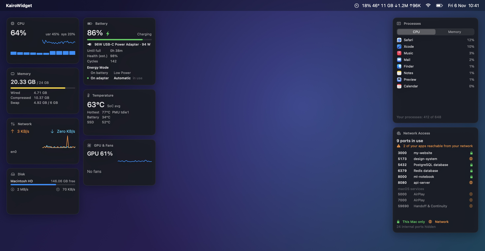
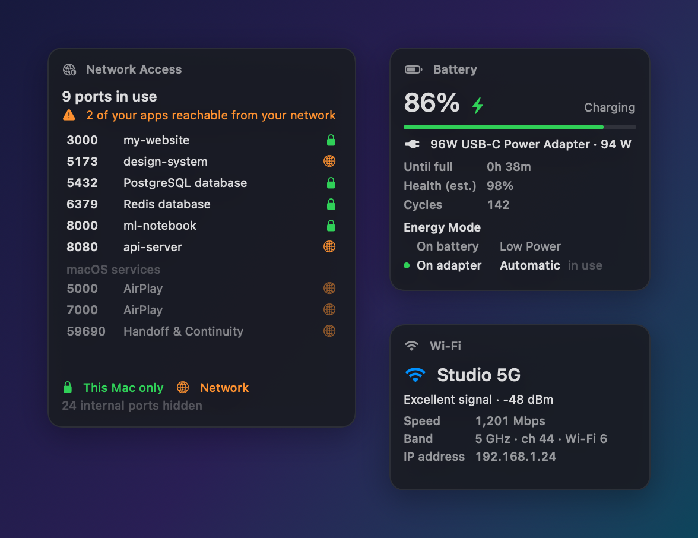

<div align="center">



# KairoWidget

**Live system widgets for your Mac desktop.**
CPU, memory, ports, battery, Wi-Fi and more — each in its own widget, placed exactly where you want it.

[](https://github.com/atanu-app/MAC-WIDGET-Public/releases/latest)
[](https://github.com/atanu-app/MAC-WIDGET-Public/releases)


[](LICENSE.md)

### [⬇︎ Download KairoWidget 1.0.0](https://github.com/atanu-app/MAC-WIDGET-Public/releases/latest)



</div>

---

## Why KairoWidget

- **One widget per metric.** Turn on only what you care about and arrange it like a dashboard.
- **Lives on your desktop.** Pin widgets behind your windows like native desktop widgets, or float them on top while you work.
- **Live, not every few minutes.** Updates every 1, 2 or 5 seconds — your choice.
- **Plain language.** "Your apps are private to this Mac" instead of `TCP 127.0.0.1:3000 LISTEN`.
- **Light.** Uses about 2% CPU with every widget open.
- **Private by design.** No accounts, no analytics, no internet connection. Everything stays on your Mac.

## Widgets

| Widget | What you see |
|---|---|
| **CPU** | Total usage, user/system split, a 2-minute graph and one bar per core. Click for 10 minutes of history and the top apps. |
| **Memory** | Memory used, a bar coloured by memory pressure, wired, compressed and swap. Click for history and the top apps. |
| **Processes** | The top 8 apps by CPU or memory, with their icons. |
| **Network Access** | Every port in use, which project or app it belongs to, and whether only this Mac or your whole network can reach it. Click a port to open it in your browser. |
| **Network** | Upload and download speed with a live graph. |
| **Disk** | Free space per volume and read/write speed. |
| **Battery** | Charge, time remaining, health, cycles, your charger's wattage and the Energy Mode in use. |
| **Temperature** | Chip average, the hottest sensor, battery and SSD temperature. |
| **GPU & Fans** | GPU usage and fan speeds (on Macs that have fans). |
| **Wi-Fi** | Network name, signal quality, link speed, band, Wi-Fi generation and your IP address. |

<div align="center">

</div>

### And a little more

- **Menu-bar readout** — CPU, temperature, memory and network speed right next to the KairoWidget icon. Pick what shows.
- **Alerts** — a notification when memory runs low, your Mac runs hot, the battery drops to 20% and 10%, or a new app opens a port to your network.
- **Stop a dev server** — right-click a project's port in Network Access and choose **Stop**. KairoWidget shows you exactly what it will stop and asks first.
- **Launch at Login** — one click in the menu.

## Requirements

- **macOS 26 Tahoe** or later
- **A Mac with Apple Silicon** (M1 or later). Intel Macs aren't supported.

## Install

1. **Download** `KairoWidget-1.0.0.dmg` from the [latest release](https://github.com/atanu-app/MAC-WIDGET-Public/releases/latest).
2. **Open the DMG** and drag **KairoWidget** into the **Applications** folder.
3. **Open KairoWidget** from Applications. The first time, macOS says *"KairoWidget" Not Opened* — click **Done**.
4. Open **System Settings → Privacy & Security**, scroll down to **Security**, and next to *"KairoWidget" was blocked to protect your Mac* click **Open Anyway**. Confirm with your password or Touch ID, then click **Open**.

That's it — the KairoWidget gauge appears in your menu bar, along with CPU, Memory and Network widgets in the top-right corner of your desktop. You only need step 4 once.

> **Why the extra step?** KairoWidget is a free, independent app and isn't notarized by Apple, so macOS asks you to confirm that you trust it the first time it opens. Every release lists SHA-256 checksums so you can check your download is the original:
>
> ```sh
> shasum -a 256 ~/Downloads/KairoWidget-1.0.0.dmg
> ```
>
> Compare the result with `SHA256SUMS.txt` on the release page.

A `.zip` of the app is also attached to each release if you prefer it to a disk image — unzip it and move **KairoWidget** to Applications, then follow steps 3–4.

## Getting started

- **Add or remove widgets:** click the gauge icon in the menu bar and tick the widgets you want.
- **Arrange them:** drag a widget anywhere. KairoWidget remembers where you put it.
- **Behind or on top:** right-click a widget and choose **Pin to Desktop** (behind your windows) or **Float on Top**.
- **Close a widget:** right-click it and choose **Close Widget**.
- **Alerts and menu-bar readout:** choose what you want under **Alerts** and **Show in Menu Bar** in the menu.
- **Update speed:** **Refresh Interval** → 1, 2 or 5 seconds.
- **Start with your Mac:** turn on **Launch at Login**.

## Permissions

KairoWidget never asks for your password or for admin rights. It may ask for:

| Permission | When | Why |
|---|---|---|
| **Notifications** | At first launch, while alerts are on | To show alerts. Without it, the **Alerts** menu tells you notifications are off. |
| **Location** | The first time you open the Wi-Fi widget | macOS only reveals the **name** of your Wi-Fi network to apps with Location access. KairoWidget never reads or stores where you are. Say no and the widget simply shows "Wi-Fi". |
| **Login Items** | Only if you turn on Launch at Login | So KairoWidget can start when you log in. |

## Privacy

KairoWidget reads system information **on your Mac only** and never sends anything anywhere: no analytics, no crash reporting, no accounts, no network connections. Your widget layout and settings are saved in one small file on your Mac. Read the full [Privacy Policy](PRIVACY.md).

## Frequently asked questions

<details>
<summary><b>macOS says KairoWidget "is damaged and can't be opened".</b></summary>

This can happen when a browser or download tool marks the file in a way that stops the **Open Anyway** button from appearing. If you downloaded KairoWidget from this page and the checksum matches, open Terminal and run:

```sh
xattr -dr com.apple.quarantine /Applications/KairoWidget.app
```

Then open KairoWidget again.
</details>

<details>
<summary><b>Why does Network Access only show some processes?</b></summary>

Without administrator rights, macOS only lets an app see processes that belong to you. Background services that run as the system (for example `root`) aren't listed. KairoWidget never asks for admin rights.
</details>

<details>
<summary><b>The GPU & Fans widget says "No fans".</b></summary>

Your Mac doesn't have fans — MacBook Air models, for example, are cooled passively. Everything else in the widget still works.
</details>

<details>
<summary><b>Temperature or fan readings disappeared after a macOS update.</b></summary>

Apple doesn't offer an official way for apps to read temperatures and fan speeds, so KairoWidget uses the same low-level system interfaces as other monitoring tools. A macOS update can change them; when that happens, the widget shows a short message instead of crashing, and a KairoWidget update will follow.
</details>

<details>
<summary><b>Is "Stop" safe? Can it close the wrong app?</b></summary>

**Stop** is only offered for development servers you started from a project folder — never for apps, editors, Terminal, or macOS itself. Before stopping anything, KairoWidget shows the exact command it will stop and asks you to confirm. It sends the same signal as pressing Ctrl+C, checks that it's still the same process right before acting, and only reports success once the port is actually free.
</details>

<details>
<summary><b>Does KairoWidget work on Intel Macs or older macOS versions?</b></summary>

No. KairoWidget requires macOS 26 Tahoe or later on a Mac with Apple Silicon.
</details>

## Uninstall

1. Click the gauge icon → **Quit KairoWidget**. If you turned on Launch at Login, turn it off first.
2. Drag **KairoWidget** from Applications to the Trash.
3. Optional — remove saved settings: delete the folder `~/Library/Application Support/MacWidget`.

## Support

Found a bug or have an idea? [Open an issue](https://github.com/atanu-app/MAC-WIDGET-Public/issues/new/choose). For security problems, please follow the [Security Policy](SECURITY.md) instead of opening a public issue.

## Release notes

See the [Changelog](CHANGELOG.md) for what's new in each version.

## License

KairoWidget is **freeware**: free to download and use on as many Macs as you like, for personal or commercial work. It may not be resold or redistributed. See the [License](LICENSE.md).

---

<sub>KairoWidget is an independent product and is not affiliated with, sponsored or endorsed by Apple Inc. Mac, macOS and Apple Silicon are trademarks of Apple Inc., registered in the U.S. and other countries.</sub>
